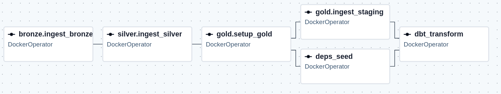

# ml-ops

- A full-stack MLOps project which aims at 3 points
    - Data: Build a data pipeline
    - AI: Automatically train model
    - Ops: Build infrastructure for running data pipeline and training model

- Todo
    - Detail documentation in each zones
    - More DQ (e.g., Great Expectation)
    - AI/Data visualization for this data

## Data pipeline

### Overview

- Data description: [Taxi trip records in New York City](https://www.nyc.gov/site/tlc/about/tlc-trip-record-data.page) is a dataset capturing all taxi trips (pickup/drop-off datetime or location, types of fee, number of passengers,...) in New York City from 2009. **The dataset contains about 1.5 billion records (~170GB).**

- This work aims to **implement a full Lambda pipeline that simulates the datasource, processes data through zones, and serves clean data to end user** (Data Analyst, Data Scientist)

- **Lambda architecture** is adopt as follows

    

    - In which, batch layer and speed layer are separated and possesses their own storage (i.e., separated batch and streaming table for each zone). Serving layer is constructed based on the combination of batch layer and speed layer.

    - Data source is simulated for batch job and streaming job. Batch job processes/transforms data based on watermark. Streaming job applies same transform logic on data obtained by CDC (Debezium or CDF). Serving layer is union from historical batch data and newest data from speed layer.

    - Medallion architecture in this work
        - Bronze: **Append-only, contain raw data, partition by month**, ready to re-run
        - Silver: Data from bronze is cleaned, transformed, deduplicated, and **upsert into Silver**
        - Gold: **Star schema is adopt**. Data from Silver is modeled and upsert into Gold zone. Maintain **SCD type 2 for dim tables**

    - Source code is packaged into modules as demonstrated in the image

- **Tech-stack** in this work is demonstrated in the following image
    

    - Datasource
        - `Postgres` is chosen to be the datasource as it natively supports **logical replication**, suited for simulating streaming source. There're also **many connector to Postgres** (Trino, Debezium, SinkJDBC)
        - CDC (`Debezium`) is used to simulated streaming data, and works well with `Kafka`

    - Batch layer focus on adopting Lakehouse architecture which supports **ACID, partition, schema evolution, schema enforcement, and data versioning**
        

        - Lakehouse:
            - `Trino` as a query engine
            - `Hive` as a metadata store
            - `Delta lake` as the table format
            - `Postgres` as a meta-database
            - AWS S3 as the object storage

        - Processing
            - `PySpark` as main processing technique
            - `dbt` for showcase
            - `Airflow` as orchestrator

    - Speed layer: Custom [Confluent stack](https://github.com/confluentinc/cp-all-in-one/blob/8.2.0-post/cp-all-in-one/docker-compose.yml) so the system is more lightweight (drop monitoring and other stuff)
        - Infra
            - `Debezium` for capturing change log from Data source and pour into a Kafka topic
            - `Kafka` as a **broker**
            - `schema-registry` for storing message's schema
            - `control-center` as a console for connector, Kafka topic, metric monitoring

        - Processing: `SparkStreaming` as main processing technique

    - **Serving layer uses Postgres with Star schema**. Both layers have their own serving tables. The batch one maintains a schema model. The speed one has its own fact table (joined coming data with dim tables from batch).

### How-to guide

This instruction shows the way to config infrastructure (i.e., how to run the system without knowing detail about it). In order to capture the logic of code, see `./airflow/README.md`

#### A brief about architecture

- [Medallion architecture](https://dev.to/datanestdigital/medallion-architecture-in-databricks-a-complete-implementation-guide-2lb9)
- [Real-time processing](https://dev.to/datanestdigital/real-time-data-streaming-with-apache-kafka-and-spark-c4l)

#### Start infrastructure

- Ref for **building infra and preparing env variables**
    - [Airflow](https://github.com/apache/airflow/blob/main/airflow-core/docs/howto/docker-compose/docker-compose.yaml)
    - [Confluent](https://github.com/confluentinc/cp-all-in-one/blob/8.2.0-post/cp-all-in-one/docker-compose.yml)
    - Read `./.env_file/*.env.example` to create `./.env_file/*.env`

- **Add Debezium (as a plugin)** into `connect` by customizing the `connect` image (see `./cdc/Dockerfile`). This custom image is used as `connect` in the compose file

    ```bash
    cd ./cdc
    docker built -t local/cp-server-connect-debezium:0.6.4-7.6.0 .
    ```

- **Config catalog** for `trino` as in `./trino/catalog/lakehouse.properties`. This config is mounted to trino in the compose file

- There are 2 `*-docker-compose.yml` files to be started. One runs `airflow`, the other creates infra for batch and speed layer. The `./.env_file/*.env` files have been referred in those compose files

- Read `Makefile` then run the following commands

    ```bash
    make up-a & make up-i
    ```

- Once `airflow` has healthily started, import environment variables (`./.env_file/*.json`, refer to `./.env_file/*.json.example`) into it so its worker can work securely with the variables

- **Build environment for jobs** (see `./airflow/README.md`)
    - Refer to `./airflow/dags/docker_env/Dockerfile` to build an env image
    - This image is used as an environment to run all jobs in this work

- After setting everything up, in the next run, just run the commands in `Makefile`

#### Datasource (see `./airflow/README.md`)

- Prepare `./tracking/track_produce_data` for tracking the generation process
- Activate dag `Produce Data`, which have 3 modes: `stream`, `batch`, `both` (choose the suitable one based on purpose)
- In order to capture changelog from datasource, Postgres should have `wal_level=logical`

#### Batch layer (see `./airflow/README.md`)



- Ref for Delta lake
    - Upsert: [Basic](https://delta.io/blog/2023-02-14-delta-lake-merge/), [Advanced](https://delta.io/blog/delta-lake-upsert/)
    - Optimize: [Overview](https://delta.io/blog/delta-lake-optimize/), [Deletion Vectors](https://delta.io/blog/2023-07-05-deletion-vectors/), [Z Order](https://delta.io/blog/2023-06-03-delta-lake-z-order/)
    - Schema: [Schema enforcement](https://delta.io/blog/2022-11-16-delta-lake-schema-enforcement/), [Schema evolution](https://delta.io/blog/2023-02-08-delta-lake-schema-evolution/)

- Prepare `./tracking/track_{bronze, silver, gold}`
- Active dag `Bronze >> Silver >> Gold` to start batch layer
    - Read the dag file to track the batch process, which starts from **loading data from source to Bronze zone (append-only); cleans, transforms, deduplicate data then upsert into Silver zone; modelings data and upsert into Gold zone**.
    - Watermark will be updated in `./tracking`. Refer to `./tracking/*.backup` to understand how to initialize those watermarks
    - Silver and Gold zone are built based on `merge` operator, so **feel free to re-run** (unless the schema is heavily damage)
    - Gold zone is built by `dbt` as it's quite easy to setup. Read more about `dbt` [here](https://medium.com/@ahmealy/dbt-incremental-models-the-complete-guide-for-postgres-users-de18356a00a7)

- Use `trino` to query delta table (setup via VSCode extension [DBCode](https://dbcode.io/) or just go straight into the container and query in there)

#### Speed layer (see `./airflow/README.md`)

- Ref for Stream processing
    - Spark Streaming: [Quick start](https://spark.apache.org/docs/latest/streaming/getting-started.html#structured-streaming-programming-guide-1), [Watermark in streaming](https://spark.apache.org/docs/latest/streaming/apis-on-dataframes-and-datasets.html#structured-streaming-programming-guide-1), [Spark - Kafka](https://spark.apache.org/docs/latest/streaming/structured-streaming-kafka-integration.html)
    - Watermark in streaming - [Explanation](https://www.youtube.com/watch?v=XjlKGvUt2dY)

- Add a CDC connector to capture changelog from Datasource and publish into a Kafka topic

    ```bash
    cd ./cdc
    sh connector_register.sh ./configs/postgres-cdc.json
    ```

    - Check the status at `control-center` (http://localhost:9021), tab `Connector`

- Trigger 3 dags: `Bronze Ingestion`, `Silver Transformation`, and `Gold Stream Modeling`. Note that
    - Since they are stream jobs, these dags will `awaitTermination`
    - `Bronze Ingestion` subscribes the CDC source. Since this job is append-only, **CDF (built-in CDC of DeltaLake) is not required**
    - `Silver Transformation`: Read stream from Bronze zone, **transform and write data to Silver zone with CDF on**. Thus, later job can capture `_change_type` such as `insert` and `update_postimage`
    - `Gold Stream Modeling`: Capture changelog from Silver zone, modeling them and overwrite to a temporary table (Postgres), then **upsert to the Serving table of speed layer**
    - These jobs read data from the previous one. Thus, they will raise errors if the previous source doesn't exist

- Speed layer generates a lot of small files, causing **small file problem** in DeltaLake. Optimization techniques (**deletion vector, compaction, z-oder, and vacuum**) are adopted to handle this problem

#### Serving layer

- A view in Postgres unions batch serving tables and stream serving table to serve newest data to end user
- The view is created as follows
    - Batch part: Query the whole batch historical data
    - Stream part: Only query from the last updated date from batch part
