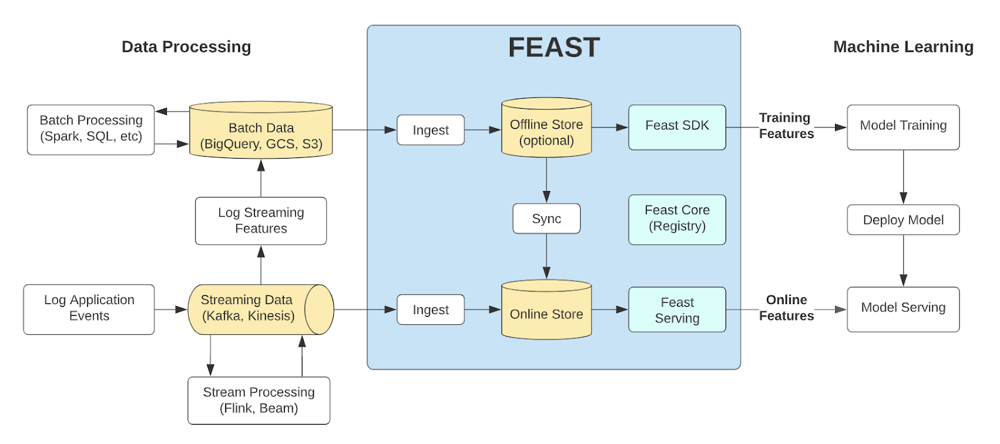

# ml-ops

A full-stack ML application, in which Ops is the main focus

- Doc:
    - Overview: `./doc/containerize_ml_app.pdf`
    - Feature store: `./doc/feature_store.pdf`

## `feast`

- Giả sử bạn được thuê làm ML Engineer cho một cty nào đó. Cty đó có một db. Nhiệm vụ là setup một ML pipeline để train, test data từ cái db đó

- Để ý rằng, cùng một đối tượng dữ liệu nhưng có thể có rất nhiều phiên bản (anh A vào ngày B đã đặt b sản phẩm, vào ngày c đặt c sản phẩm,...). Chúng ta phải quản lý như thế nào, chọn cái nào để train model? Ngoài ra, việc tái sử dụng feature, việc đảm bảo có thể truy vết lại xem model đã được train với các feature nào, việc trả kết quả real-time khi infer cũng rất quan trọng. Và thế là chúng ta có `feast`



- `feast` tạo ra flow dữ liệu như trên để đáp ứng những như cầu như quản lý, đồng nhất phiên bản, chạy real-time, tái sử dụng feature (thường lúc train, lúc test, hoặc lúc kiếm lại feature, người ta sẽ không sử dụng được đúng phiên bản trước đây đã từng sử dụng). 2 thành phần chính:
    - `offline store`:
        - Trong db bao gồm nhiều bảng (dim table). Bạn sẽ thiết kế một bảng fact, cập nhật theo giờ (chẳng hạn). Đó chính là `offline store` của bạn. Nó sẽ có các phiên bản lịch sử trông như sau

            ```bash
                        event_timestamp   driver_id  conv_rate  acc_rate  avg_daily_trips                 created
            0  2025-08-26 14:00:00+00:00       1005   0.561099  0.834281               82 2025-09-10 14:23:27.657
            1  2025-08-26 15:00:00+00:00       1005   0.012789  0.393956              685 2025-09-10 14:23:27.657
            2  2025-08-26 16:00:00+00:00       1005   0.285823  0.312395              213 2025-09-10 14:23:27.657
            3  2025-08-26 17:00:00+00:00       1005   0.971752  0.544306               54 2025-09-10 14:23:27.657
            ```

        - Thường là một data warehouse. Trong project này thì là một postgres database. DB này chứa thông tin dành cho huấn luyện, được lấy (và tiền xử lý một phần) từ DB gốc của cty.

    - `online store`: Sau khi lấy data từ DB gốc về `offline_store`, các giá trị mới nhất của một đối tượng dữ liệu sẽ được sync (`materialize`) qua bên `online store` để phục vụ inference

- Các thao tác chính trong `feast`:
    - `feast init feature_store -t postgres`: Khởi tạo project `feature_store` với template là `postgres`. Nó bao gồm 1 registry db để lưu metadata, một online store db và 1 offline store db (cần phải tạo thủ công các db này trước khi gọi lệnh này)
    - `feast apply`: Sau khi định nghĩa *các đối tượng chính trong `feast`* (sẽ nói sau), `feast apply` được sử dụng để hiện thực hóa các definitions (có thể coi các file định nghĩa như các IaC):
        - `feature_store.yml`: Chứa định nghĩa cho các db
        - `feature_repo.py`: chứa định nghĩa cho *các đối tượng chính trong `feast`* (sẽ nói sau)
    - `materialize`: Sync dữ liệu từ `offline store` sang `online store`, có thể kèm thêm các thuộc tính real-time (ví dụ: vị trí của user khi gửi request, thời gian user request,...). Phục vụ cho inference ở `online store`
    - `get_historical_features`
    - `get_online_features`

- Các đối tượng chính trong `feast`
    - `Entity`
    - `FeatureView`
    - `FeatureService`


<!-- note: khi tiền xử lý dữ liệu để đưa vào feature store, chỉ cần tiền xử lý cho đúng logic dữ liệu (order date thì dtype là datetime, profit thì dtype là float) chứ không cần quá chi tiết (one hot encoding, min-max scale,...) -->